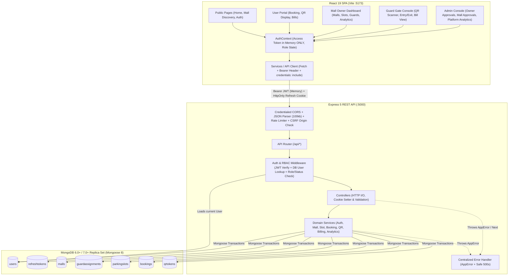
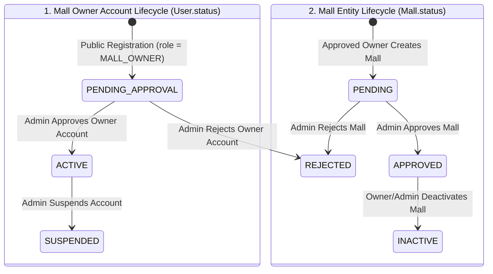
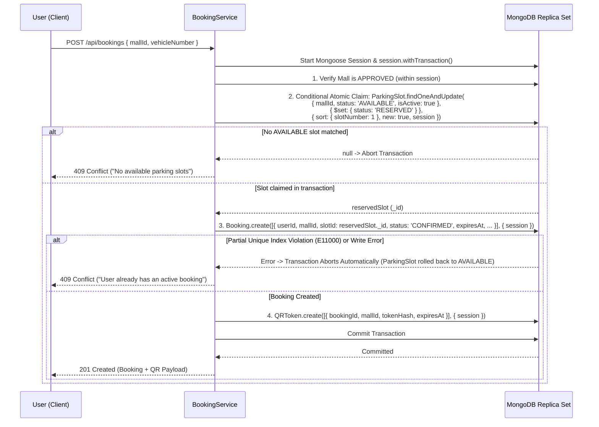

# ParkEase — System Architecture (`docs/ARCHITECTURE.md`)

> **Document Status:** Milestone 0 Approved Architecture Baseline (Finalized)
> **Repository:** `https://github.com/itzshikharofficial12/ParkEase`
> **Scope:** Full MVP Architecture, Component Boundaries, Security Model, and Replica-Set Transaction Strategy

---

## 1. Executive Overview

**ParkEase** is a Smart Mall Parking Intelligence System built on the MERN stack (`MongoDB`, `Express 5`, `React 19`, `Node.js >= 22.12`) organized as an npm workspace monorepo (`client` and `server`).

ParkEase manages the complete parking lifecycle across four distinct actors:
1. **`USER`** — Discovers approved malls, checks real-time slot availability, reserves a parking slot (maximum one active booking at a time), presents a cryptographic QR token at the mall gate, and views calculated parking bills and booking history.
2. **`MALL_OWNER`** — Registers publicly (subject to Admin account approval), submits mall profiles (subject to separate Admin mall approval), configures parking slots and hourly pricing, provisions and assigns `GUARD` accounts to their malls, and views mall-scoped occupancy and revenue analytics.
3. **`GUARD`** — Operates at a specific assigned mall (`GuardAssignment`), verifies customer QR tokens at entry and exit gates, triggers transactional state transitions (`CONFIRMED -> ACTIVE` on entry, `ACTIVE -> COMPLETED` on exit), and views real-time gate verification results and generated exit bills.
4. **`ADMIN`** — Approves or rejects `MALL_OWNER` accounts, approves or rejects submitted `Mall` entities, provisions `GUARD` accounts when needed, and monitors platform-wide operational and financial analytics.

---

## 2. Current Repository Audit & Baseline Assessment

### 2.1 Existing Monorepo Structure
```text
ParkEase/
├── client/                          # React 19 + Vite 7 frontend workspace (parkease-client)
│   ├── public/favicon.svg
│   ├── src/
│   │   ├── assets/.gitkeep
│   │   ├── components/
│   │   │   ├── FeatureCard.jsx      # Landing page feature card
│   │   │   ├── Footer.jsx           # Site footer
│   │   │   ├── Navbar.jsx           # Public top navigation bar
│   │   │   └── PageContainer.jsx    # Standard layout wrapper for simple pages
│   │   ├── pages/
│   │   │   ├── DashboardPage.jsx    # Public placeholder for future dashboards
│   │   │   ├── HomePage.jsx         # Landing page with live /api/health check (5s timeout)
│   │   │   ├── LoginPage.jsx        # Placeholder page
│   │   │   ├── NotFoundPage.jsx     # 404 catch-all route page
│   │   │   └── RegisterPage.jsx     # Placeholder page
│   │   ├── services/
│   │   │   └── api.js               # Base fetch wrapper (VITE_API_URL)
│   │   ├── utils/.gitkeep
│   │   ├── App.jsx                  # React Router v7 route definitions
│   │   ├── index.css                # Global design tokens and responsive CSS
│   │   └── main.jsx                 # React DOM root + BrowserRouter
│   ├── .env.example
│   ├── index.html
│   ├── package.json
│   └── vite.config.js               # Port 5173, strictPort: true
├── server/                          # Express 5 + Mongoose 8 backend workspace (parkease-server)
│   ├── src/
│   │   ├── config/
│   │   │   └── db.js                # Mongoose connection + URI protocol validation
│   │   ├── constants/
│   │   │   ├── roles.js             # ROLES = { USER, MALL_OWNER, GUARD, ADMIN }
│   │   │   └── statuses.js          # Domain status enums (USER, MALL, SLOT, BOOKING, BILLING, QR)
│   │   ├── controllers/
│   │   │   └── healthController.js  # GET /api/health handler
│   │   ├── middleware/
│   │   │   ├── errorHandler.js      # Centralized error boundary (AppError + sanitized 500s)
│   │   │   └── notFound.js          # JSON 404 handler
│   │   ├── models/
│   │   │   ├── User.js              # User schema & model
│   │   │   └── RefreshToken.js      # RefreshToken schema & model (SHA-256 tokenHash)
│   │   ├── routes/
│   │   │   ├── healthRoutes.js      # Mounts GET /
│   │   │   └── index.js             # Mounts /health under /api
│   │   ├── services/.gitkeep        # Domain services (Phase 1B+)
│   │   ├── utils/
│   │   │   ├── AppError.js          # Operational error class
│   │   │   ├── cookies.js           # HttpOnly refresh cookie & TTL helpers
│   │   │   ├── jwt.js               # HS256 access JWT + opaque refresh token & SHA-256 helpers
│   │   │   ├── password.js          # bcryptjs password hashing & verification
│   │   │   └── validators.js        # Email, password, ObjectId, and required-field validators
│   │   ├── app.js                   # Express 5 app setup (cors, json 100kb, routes, middleware)
│   │   └── server.js                # dotenv bootstrap, connectDB(), port validation, app.listen()
│   ├── test/
│   │   ├── app.test.js              # Foundation API & DB config tests
│   │   └── auth-utils.test.js       # Milestone 1A auth utilities & model unit tests
│   ├── .env.example
│   └── package.json
├── docs/                            # Architectural & milestone documentation
├── CONTRIBUTING.md                  # Legacy 4-person team guide (superseded by solo workflow in docs/)
├── README.md                        # Repository overview & setup instructions
├── eslint.config.mjs                # Root flat ESLint v9 config covering client & server
└── package.json                     # Root workspace configuration & scripts
```

### 2.2 Technical Strengths of the Foundation
- **Clean App/Server Separation:** `server/src/app.js` exports the configured Express 5 application without binding a port or connecting to MongoDB, enabling fast, isolated HTTP testing in `server/test/app.test.js` via ephemeral ports (`app.listen(0, "127.0.0.1")`).
- **Express 5 Native Promise Rejection Handling:** Express 5 (`^5.1.0`) automatically forwards rejected promises from `async` route handlers and middleware to `errorHandler.js` without requiring `express-async-handler` wrappers.
- **Credential-Safe Startup & Error Boundary:** `server.js` and `errorHandler.js` suppress raw stack traces and connection strings so database credentials never leak to logs or HTTP clients, while operational `AppError` instances (`4xx`) return structured error responses.
- **Zero-Bloat Testing:** Uses Node.js 22's built-in `node:test` and `node:assert/strict` modules along with native `fetch`.

---

## 3. High-Level System Architecture



---

## 4. Backend Layered Architecture & Responsibilities

The backend preserves the modular structure under `server/src/` (with `server/src/scripts/` for operational CLI scripts such as Admin seeding):

| Layer | Directory | Core Responsibility | Prohibited Actions |
| :--- | :--- | :--- | :--- |
| **Configuration** | `server/src/config/` | Database connection (`db.js`), environment validation. | Business logic, HTTP handling. |
| **Constants** | `server/src/constants/` | Immutable domain enums: `roles.js`, `statuses.js` (user, mall, slot, booking, billing, QR token states). | Stateful code, database imports. |
| **Routes** | `server/src/routes/` | Express `Router` definitions, path mapping, middleware chaining (`authenticate`, `authorize`, rate limiters). | Direct `req`/`res` manipulation, database queries. |
| **Middleware** | `server/src/middleware/` | Cross-cutting HTTP pipeline steps: JWT verification + database user lookup, RBAC checks, CSRF/Origin checks, input validation, error handling. | Complex domain mutations. |
| **Controllers** | `server/src/controllers/` | Extract `req.params`, `req.query`, `req.body`, `req.user`, `HttpOnly` cookies; invoke Service methods; set/clear cookies; return standardized JSON responses (`200`, `201`). | Direct `Model.find()`/`save()` calls, complex state machine transitions. |
| **Services** | `server/src/services/` | Core domain logic, state machine enforcement, Mongoose transactions (`session.withTransaction()`), conditional atomic slot updates, QR verification, billing math, Mongoose queries. | Referencing `req` or `res` objects directly. |
| **Models** | `server/src/models/` | Mongoose schemas, field types, compound indexes, partial unique indexes, schema transforms. | Importing services or controllers (prevents circular dependencies). |
| **Utilities** | `server/src/utils/` | Stateless helpers (`AppError.js`, `jwt.js`, `cookies.js`, `password.js`, `validators.js`, `pricing.js`). | Database calls or stateful side effects. |
| **Scripts** | `server/src/scripts/` | CLI maintenance/bootstrap scripts (`seedAdmin.js`). | Imported by HTTP request handlers. |

---

## 5. Critical Domain Workflows & Architectural Validation

### 5.1 Authentication, Database-Backed Identity, In-Memory Access Tokens & HttpOnly Refresh Cookies

ParkEase separates short-lived API authorization from long-lived session persistence:

1. **Access Token (Short-Lived JWT in React Memory):**
   - Issued with a 15-minute expiry (`JWT_ACCESS_EXPIRES_IN=15m`) signed with `HS256` using a `>= 32`-byte `JWT_ACCESS_SECRET` and containing `{ sub: userId, role, status }`.
   - Returned in the JSON response body of `POST /api/auth/register`, `POST /api/auth/login`, and `POST /api/auth/refresh`.
   - Stored **exclusively in React memory** (`AuthContext` state / module-scoped variable in `api.js`), **never** in `localStorage` or `sessionStorage`.
   - Attached to API requests via `Authorization: Bearer <accessToken>`.
2. **Database-Backed Authentication Middleware (`authenticate`):**
   - Rather than relying exclusively on potentially stale `role` or `status` claims embedded in the 15-minute JWT (for example, if an Admin approves, rejects, or suspends an account after the token was minted), the `authenticate` middleware performs five steps:
     1. Verifies the access JWT signature and expiration (`verifyAccessToken(token)`).
     2. Extracts the subject user ID (`decoded.sub`).
     3. Loads the current user document from MongoDB (`await User.findById(decoded.sub)`).
     4. Verifies the user exists and inspects the live database `status` and `role` (immediately rejecting `SUSPENDED` or `REJECTED` accounts).
     5. Attaches the current database-backed user identity (`req.user = { id: user._id.toString(), name: user.name, email: user.email, role: user.role, status: user.status }`) to `req.user`.
3. **Refresh Token (`HttpOnly` Cookie + Hashed DB State):**
   - Generated as a cryptographically random 32-byte opaque token (`crypto.randomBytes(32).toString("hex")`) with a 7-day expiry (`JWT_REFRESH_EXPIRES_IN=7d`).
   - **Never** exposed in JSON response bodies and **never** stored in `localStorage`.
   - Both the `HttpOnly` cookie `maxAge` and the MongoDB `RefreshToken.expiresAt` timestamp are derived from the same helper (`getRefreshTokenTtlMs()` / `getRefreshTokenExpiryDate()` in `server/src/utils/cookies.js`).
   - Stored in MongoDB (`RefreshToken` collection) **only as a SHA-256 hash** (`tokenHash`), linked to a rotation `familyId`.
   - Delivered to the browser via `Set-Cookie` (`parkease_refresh_token`):
     - **Local Development (`NODE_ENV !== "production"`):** `HttpOnly; Path=/api/auth; SameSite=Lax; Max-Age=604800` (`Secure=false` so `http://localhost` works without TLS).
     - **Production (`NODE_ENV === "production"`):** `HttpOnly; Secure; Path=/api/auth; SameSite=Strict; Max-Age=604800` (if frontend and backend are deployed cross-site on separate domains, adjust to `SameSite=None; Secure` alongside strict `Origin` verification).
4. **Refresh Token Rotation & Reuse Detection:**
   - On page reload (`AuthContext` initialization) or when an API request fails with `401 Unauthorized`, the frontend calls `POST /api/auth/refresh` with `credentials: "include"`.
   - The server hashes the incoming `parkease_refresh_token` cookie, looks up the `RefreshToken` record, and checks if `revokedAt` is already set.
   - **If `revokedAt` is set (Token Reuse Detected):** The server immediately revokes **all** refresh tokens sharing that `familyId`, clears the cookie, and returns `401 Unauthorized`.
   - **If valid:** The server marks the current `RefreshToken` as revoked (`revokedAt = now`, `replacedByTokenHash = newHash`), inserts a new `RefreshToken` in the same `familyId`, sets the rotated `HttpOnly` cookie, and returns a fresh `accessToken` in the JSON response.
5. **Credentialed CORS & CSRF Protection on `/api/auth/refresh` and `/api/auth/logout`:**
   - **Strict Cookie Path & SameSite:** `Path=/api/auth` prevents the cookie from being sent to any business endpoint (`/api/bookings`, `/api/malls`, etc.), and `SameSite=Lax` / `Strict` blocks cross-site subresource `POST` requests.
   - **Origin Header Verification Middleware (`verifyCsrfProtection`):** Verifies that `req.headers.origin` (when present) strictly matches `process.env.CLIENT_URL || "http://localhost:5173"`.
   - **Custom Header Requirement (`X-Requested-With: XMLHttpRequest`):** Enforced on `/api/auth/refresh` and `/api/auth/logout`.

---

### 5.2 Two-Stage Approval Architecture (Mall Owner Account vs. Mall Entity)
A core product requirement is that **Mall Owner account approval** and **Mall approval** are distinct lifecycles:



- **Why this separation matters:**
  - A `MALL_OWNER` with `User.status === "PENDING_APPROVAL"` can log in and view their pending onboarding status on their dashboard, but **cannot** create malls, create slots, or provision guards (`403 Forbidden` via `requireApprovedOwner` middleware).
  - Once `User.status === "ACTIVE"`, the owner can create one or more `Mall` records. Each new `Mall` starts with `Mall.status === "PENDING"`.
  - While a `Mall` is `PENDING`, the owner can configure its metadata and pre-populate `ParkingSlot` inventory, but public users cannot discover or book slots in that mall until an `ADMIN` transitions `Mall.status` to `APPROVED`.

---

### 5.3 Guard Provisioning & Mall-Scoped Authorization (`GuardAssignment`)
- Guards (`role === "GUARD"`) cannot self-register publicly.
- Guards are provisioned either by:
  1. An approved `MALL_OWNER` (for a mall owned by that `MALL_OWNER`), or
  2. An `ADMIN` (for any mall).
- When a Guard is created or assigned, a `GuardAssignment` document links `guardId` (`User`) to `mallId` (`Mall`) with `isActive: true`.
- Every guard operation (QR scan, gate entry, gate exit) validates via `GuardAssignment` that the authenticated guard is actively assigned to the target booking's `mallId`. A guard assigned to Mall A receives `403 Forbidden` if attempting to scan a QR token for Mall B.

---

### 5.4 MongoDB Replica-Set Transactions & Atomic Slot Allocation

Parking slot reservation enforces two strict concurrency invariants:
1. **No Double-Booking of a Slot:** Concurrent requests for the last `AVAILABLE` slot in a mall must result in at most one `201 Created` and `409 Conflict` for all losing requests.
2. **One Active Booking Per User:** A user cannot hold more than one booking in `CONFIRMED` or `ACTIVE` status simultaneously, even if they fire parallel requests.

#### Frozen Transaction & Concurrency Architecture
ParkEase requires a **MongoDB Replica Set** (such as MongoDB Atlas or a local single-node replica set `rs0`) or sharded cluster and enforces multi-document consistency using three complementary layers:

1. **Multi-Document ACID Transactions (`session.withTransaction()`):**
   - Booking creation, slot reservation (`ParkingSlot`), and QR token creation (`QRToken`) execute inside a single Mongoose transaction (`mongoose.startSession()` + `session.withTransaction()`).
   - If any write fails (e.g., user already has an active booking, QR token creation error, or process crash), MongoDB automatically aborts the transaction and rolls back all document changes atomically — no slot can ever be left orphaned in `RESERVED` state without a corresponding `Booking`.
   - Cancellation (`Booking -> CANCELLED`, `QRToken -> REVOKED`, `ParkingSlot -> AVAILABLE`), gate entry (`Booking -> ACTIVE`, `ParkingSlot -> OCCUPIED`, `QRToken.entryScannedAt`), gate exit (`Booking -> COMPLETED`, `QRToken -> CONSUMED`, `ParkingSlot -> AVAILABLE`), and reservation expiry (`Booking -> EXPIRED`, `QRToken -> EXPIRED`, `ParkingSlot -> AVAILABLE`) likewise execute inside Mongoose transactions.
2. **Atomic Conditional Slot Updates (`findOneAndUpdate` inside the Transaction):**
   - Inside the transaction session, slot allocation uses a conditional `ParkingSlot.findOneAndUpdate({ mallId, status: "AVAILABLE", isActive: true }, { $set: { status: "RESERVED" } }, { sort: { slotNumber: 1 }, new: true, session })` query as an additional concurrency safeguard so concurrent transactions immediately detect slot contention.
3. **Partial Unique Indexes on `Booking`:**
   - `unique_active_booking_per_user`: `{ userId: 1 }` with `partialFilterExpression: { status: { $in: ["CONFIRMED", "ACTIVE"] } }`.
   - `unique_active_booking_per_slot`: `{ slotId: 1 }` with `partialFilterExpression: { status: { $in: ["CONFIRMED", "ACTIVE"] } }`.



#### Local Single-Node Replica Set Setup
To support Mongoose transactions during local development, start local MongoDB as a single-node replica set (`rs0`) or use a MongoDB Atlas cluster:
```bash
# 1. Start mongod with --replSet rs0
mongod --replSet rs0 --dbpath /usr/local/var/mongodb --bind_ip 127.0.0.1 --port 27017

# 2. Initialize the single-node replica set once via mongosh
mongosh --eval 'rs.initiate({ _id: "rs0", members: [{ _id: 0, host: "127.0.0.1:27017" }] })'

# 3. Set MONGODB_URI in server/.env
MONGODB_URI=mongodb://127.0.0.1:27017/parkease?replicaSet=rs0
```

---

### 5.5 QR Verification, Entry, Exit & Provisional Billing Lifecycle
1. **Booking Creation (`CONFIRMED`):** Within the booking creation transaction, the server generates a cryptographically random secret token, stores its SHA-256 hash in `QRToken` (`status: "ACTIVE"`), and returns the QR token string to the authenticated booking owner.
2. **Gate Entry (`CONFIRMED -> ACTIVE`):**
   - Guard scans QR token -> `POST /api/operations/entry`.
   - Server verifies Guard's `GuardAssignment` for the booking's `mallId`.
   - Inside a Mongoose transaction, the server conditionally transitions `Booking` (`{ _id, status: "CONFIRMED" } -> { status: "ACTIVE", entryTime: now }`), transitions `ParkingSlot` (`{ _id: slotId, status: "RESERVED" } -> { status: "OCCUPIED" }`), and sets `entryScannedAt` on `QRToken` (preventing entry replay).
3. **Gate Exit & Billing (`ACTIVE -> COMPLETED`):**
   - Guard scans QR token -> `POST /api/operations/exit`.
   - Inside a Mongoose transaction, the server conditionally transitions `Booking` (`{ _id, status: "ACTIVE" } -> { status: "COMPLETED", exitTime: now }`), consumes `QRToken` (`status: "CONSUMED"`, `exitScannedAt: now`), and releases `ParkingSlot` (`{ _id: slotId, status: "OCCUPIED" } -> { status: "AVAILABLE" }`).
4. **Provisional Billing Policy (Requires Product Confirmation Before Milestone 4):**
   - **Provisional MVP Default:**
     - `durationMinutes = Math.max(1, Math.ceil((exitTime - entryTime) / 60000))`
     - `billableHours = Math.max(1, Math.ceil(durationMinutes / 60))` (minimum 1-hour charge; partial hours rounded up to the next full hour).
     - `calculatedAmount = billableHours * hourlyRateSnapshot` (using the mall's hourly rate snapshotted at booking creation time).
   - **Product Decision Gate:** This ceiling-based hourly calculation and 1-hour minimum charge is a **provisional MVP default** and must be explicitly confirmed before implementing the Milestone 4 billing service.

---

## 6. Frontend Architecture Evolution

The React 19 frontend (`client/src/`) will evolve incrementally from the current foundation without rewriting existing working styles or layout primitives:

```text
client/src/
├── assets/
├── components/
│   ├── FeatureCard.jsx          # Existing
│   ├── Footer.jsx               # Existing
│   ├── Navbar.jsx               # Existing (evolve to become auth & role-aware)
│   ├── PageContainer.jsx        # Existing
│   ├── ProtectedRoute.jsx       # Route guard checking authentication & allowed roles
│   ├── StatusBadge.jsx          # Reusable badge for Booking/Slot/Mall statuses
│   └── LoadingSpinner.jsx       # Standardized loading state
├── context/
│   └── AuthContext.jsx          # Holds user profile & accessToken in memory; calls /auth/refresh on mount
├── hooks/
│   └── useAuth.js               # Convenience hook for consuming AuthContext
├── pages/
│   ├── HomePage.jsx             # Existing
│   ├── LoginPage.jsx            # Existing (upgrade from placeholder to functional form)
│   ├── RegisterPage.jsx         # Existing (upgrade to support USER and MALL_OWNER tabs)
│   ├── DashboardPage.jsx        # Existing (upgrade to role-based router/dispatcher)
│   ├── NotFoundPage.jsx         # Existing
│   ├── malls/                   # Public mall discovery & slot availability views
│   ├── user/                    # User active booking, QR code view, booking/bill history
│   ├── owner/                   # Mall Owner onboarding banner, mall/slot/guard CRUD, analytics
│   ├── guard/                   # Guard gate scanner (QR input/camera), entry/exit confirmation
│   └── admin/                   # Admin owner approvals, mall approvals, platform analytics
├── services/
│   ├── api.js                   # Existing (enhance with in-memory Bearer token, credentials: "include", 401 refresh retry)
│   ├── authService.js           # Auth API calls
│   ├── mallService.js           # Mall & slot API calls
│   ├── bookingService.js        # Booking & QR API calls
│   └── adminService.js          # Admin approval & analytics API calls
└── utils/
    └── constants.js             # Frontend mirror of ROLES and status labels
```

---

## 7. Security Boundaries & Trust Model

1. **Frontend vs. Backend Trust Boundary:**
   - React Router guards (`ProtectedRoute.jsx`) and role-based UI visibility exist strictly for user experience.
   - The Express backend enforces authentication (`authenticate` middleware loading the live `User` document from MongoDB), role authorization (`authorize(...roles)` middleware), account state (`User.status === "ACTIVE"`), and resource ownership (`Mall.ownerId === req.user.id` or `GuardAssignment`) on every protected endpoint.
2. **Token Storage & Transport Security:**
   - Access tokens live only in JavaScript memory (`AuthContext` / `api.js`), eliminating persistent XSS theft from `localStorage`.
   - Refresh tokens are opaque 32-byte random values that live only in an `HttpOnly`, path-restricted (`Path=/api/auth`), `SameSite` cookie and are stored as SHA-256 hashes in MongoDB.
   - CSRF protection is enforced via `SameSite` cookie attributes, `Origin` verification (`CLIENT_URL`), and custom header verification (`X-Requested-With: XMLHttpRequest`).
3. **Never Trust Client-Supplied Authority Fields:**
   - `userId`, `ownerId`, `guardId`, `entryTime`, `exitTime`, `hourlyRate`, `calculatedAmount`, and approval statuses are **never** accepted from request payloads; they are derived exclusively from the database-backed `req.user`, server clock (`new Date()`), and database state.
4. **Privilege Escalation Prevention & Admin Bootstrap:**
   - Public registration (`POST /api/auth/register`) only permits `role: "USER"` (immediately `ACTIVE`) or `role: "MALL_OWNER"` (forced to `status: "PENDING_APPROVAL"`).
   - `ADMIN` accounts are provisioned exclusively via the idempotent server-side bootstrap script (`npm run seed:admin --workspace server`).
5. **Environment & Secret Isolation:**
   - `client/.env` (`VITE_*`) contains only the public API base URL (`VITE_API_URL`).
   - JWT signing secrets (`JWT_ACCESS_SECRET` `>= 32` bytes), `ADMIN_PASSWORD`, and `MONGODB_URI` reside exclusively in `server/.env`.
