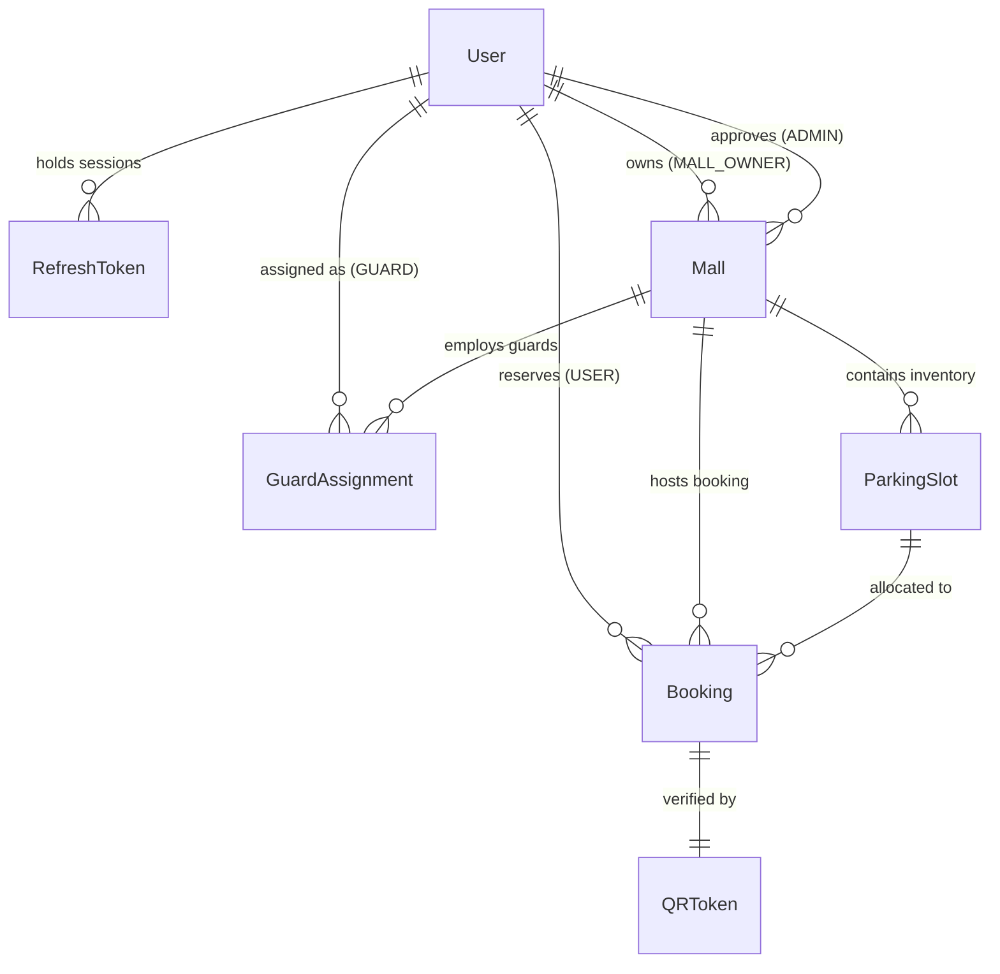

# ParkEase — Database Architecture & Entity Design (`docs/DATABASE_DESIGN.md`)

> **Document Status:** Milestone 0 Approved Schema & Index Specification (Finalized)
> **Database Engine:** MongoDB 6.0+ / 7.0+ / 8.0+ Replica Set with Mongoose 8 (`^8.19.2`)
> **Scope:** Complete Entity-Relationship Model, Field Specifications, Status Enums, Unique Constraints, Concurrency Indexes, and Replica-Set Transaction Architecture

---

## 1. Entity-Relationship Overview

ParkEase models seven core collections in MongoDB:
1. **`User`** (`users`) — All actors (`USER`, `MALL_OWNER`, `GUARD`, `ADMIN`) and their account approval/lifecycle status.
2. **`RefreshToken`** (`refreshtokens`) — Stateful refresh token sessions storing only SHA-256 token hashes (`tokenHash`) of opaque random tokens to back `HttpOnly` cookie rotation, reuse detection, and revocation.
3. **`Mall`** (`malls`) — Mall profiles submitted by approved `MALL_OWNER` accounts and approved by `ADMIN`.
4. **`GuardAssignment`** (`guardassignments`) — Maps `GUARD` users to the specific `Mall` where they are authorized to operate gates.
5. **`ParkingSlot`** (`parkingslots`) — Individual physical parking spaces within a `Mall` and their real-time occupancy state.
6. **`Booking`** (`bookings`) — Reservation lifecycle, entry/exit timestamps, rate snapshot, and generated billing data.
7. **`QRToken`** (`qrtokens`) — Server-verifiable cryptographic token metadata bound 1:1 to a `Booking` to prevent forgery and replay attacks.



---

## 2. Canonical Status & Role Enums (`server/src/constants/`)

All status values are stored as uppercase string constants exported from `server/src/constants/roles.js` and `server/src/constants/statuses.js`.

### 2.1 User Roles (`ROLES` in `server/src/constants/roles.js`)
| Enum Key | Value | Description |
| :--- | :--- | :--- |
| `USER` | `"USER"` | Standard customer booking parking slots. |
| `MALL_OWNER` | `"MALL_OWNER"` | Commercial partner managing malls, slots, and guards. |
| `GUARD` | `"GUARD"` | Operational staff verifying QR codes and recording gate entry/exit. |
| `ADMIN` | `"ADMIN"` | Platform administrator approving owners/malls and viewing global analytics. |

### 2.2 User Account Status (`USER_STATUS`)
| Enum Key | Value | Allowed Transitions | Description |
| :--- | :--- | :--- | :--- |
| `PENDING_APPROVAL` | `"PENDING_APPROVAL"` | `-> ACTIVE`, `-> REJECTED` | Initial state for publicly registered `MALL_OWNER` accounts. |
| `ACTIVE` | `"ACTIVE"` | `-> SUSPENDED` | Default initial state for `USER`, `GUARD`, and `ADMIN`; approved state for `MALL_OWNER`. |
| `REJECTED` | `"REJECTED"` | `-> ACTIVE` *(Admin re-review)* | `MALL_OWNER` registration rejected by Admin. |
| `SUSPENDED` | `"SUSPENDED"` | `-> ACTIVE` | Account disabled by Admin or Mall Owner (for their Guard). |

### 2.3 Mall Approval Status (`MALL_STATUS`)
| Enum Key | Value | Allowed Transitions | Description |
| :--- | :--- | :--- | :--- |
| `PENDING` | `"PENDING"` | `-> APPROVED`, `-> REJECTED` | Initial state when an active `MALL_OWNER` submits a new mall. |
| `APPROVED` | `"APPROVED"` | `-> INACTIVE` | Approved by `ADMIN`; visible in public discovery and open for bookings. |
| `REJECTED` | `"REJECTED"` | `-> PENDING` *(on owner resubmission)* | Rejected by `ADMIN` with `rejectionReason`. |
| `INACTIVE` | `"INACTIVE"` | `-> APPROVED` | Temporarily closed for new bookings by Owner or Admin. |

### 2.4 Parking Slot Status (`SLOT_STATUS`)
| Enum Key | Value | Allowed Transitions | Description |
| :--- | :--- | :--- | :--- |
| `AVAILABLE` | `"AVAILABLE"` | `-> RESERVED`, `-> MAINTENANCE` | Free to be allocated to a new booking. |
| `RESERVED` | `"RESERVED"` | `-> OCCUPIED` *(on entry)*, `-> AVAILABLE` *(on cancellation or expiry)* | Claimed by a `CONFIRMED` booking before vehicle entry. |
| `OCCUPIED` | `"OCCUPIED"` | `-> AVAILABLE` *(on exit)* | Vehicle has passed entry verification (`ACTIVE` booking). |
| `MAINTENANCE` | `"MAINTENANCE"` | `-> AVAILABLE` | Temporarily taken out of service by `MALL_OWNER`; cannot be allocated. |

*(Note: Physical soft-deactivation is controlled by `isActive: Boolean` on `ParkingSlot` in addition to operational `status`.)*

### 2.5 Booking Status (`BOOKING_STATUS`) & Billing Status (`BILLING_STATUS`)
| Enum Key | Value | Allowed Transitions | Description |
| :--- | :--- | :--- | :--- |
| `CONFIRMED` | `"CONFIRMED"` | `-> ACTIVE`, `-> CANCELLED`, `-> EXPIRED` | Slot reserved; awaiting vehicle arrival and QR entry scan before `expiresAt`. **(Counts as Active Booking)** |
| `ACTIVE` | `"ACTIVE"` | `-> COMPLETED` | Vehicle entered mall; timer running. **(Counts as Active Booking)** |
| `COMPLETED` | `"COMPLETED"` | *(Terminal)* | Vehicle exited mall; duration and bill generated; slot released. |
| `CANCELLED` | `"CANCELLED"` | *(Terminal)* | Cancelled by user prior to gate entry; slot released. |
| `EXPIRED` | `"EXPIRED"` | *(Terminal)* | Unclaimed booking expired after `expiresAt` prior to entry; slot released. |

- **`BILLING_STATUS`**:
  - `PENDING` (`"PENDING"`) — Default while booking is `CONFIRMED` or `ACTIVE`.
  - `GENERATED` (`"GENERATED"`) — Final bill calculated upon transition to `COMPLETED`.
  - `WAIVED` (`"WAIVED"`) — Set when booking ends in `CANCELLED` or `EXPIRED` with zero charge.

### 2.6 QR Token Status (`QR_TOKEN_STATUS`)
| Enum Key | Value | Allowed Transitions | Description |
| :--- | :--- | :--- | :--- |
| `ACTIVE` | `"ACTIVE"` | `-> CONSUMED`, `-> REVOKED`, `-> EXPIRED` | Valid for gate verification (entry when booking is `CONFIRMED`, exit when `ACTIVE`). |
| `CONSUMED` | `"CONSUMED"` | *(Terminal)* | Both entry and exit scans completed; cannot be reused. |
| `REVOKED` | `"REVOKED"` | *(Terminal)* | Invalidated due to booking cancellation. |
| `EXPIRED` | `"EXPIRED"` | *(Terminal)* | Invalidated due to booking expiry. |

---

## 3. Detailed Entity Specifications

### 3.1 `User` (`server/src/models/User.js`)

Represents all registered platform actors.

| Field | Mongoose Type | Required | Default | Constraints / Notes |
| :--- | :--- | :--- | :--- | :--- |
| `_id` | `ObjectId` | Auto | Auto | Primary key. |
| `name` | `String` | Yes | — | `trim: true`, `minlength: 2`, `maxlength: 100`. |
| `email` | `String` | Yes | — | `unique: true`, `lowercase: true`, `trim: true`, email regex validation. |
| `passwordHash` | `String` | Yes | — | `select: false`, stripped in `toJSON` and `toObject`. Bcrypt hash. |
| `phone` | `String` | No | `null` | `trim: true`, `maxlength: 20`. |
| `role` | `String` | Yes | `"USER"` | `enum: Object.values(ROLES)`. Immutable via self-profile updates. |
| `status` | `String` | Yes | `"ACTIVE"` | `enum: Object.values(USER_STATUS)`. Set to `"PENDING_APPROVAL"` when `role === "MALL_OWNER"`. |
| `approvedBy` | `ObjectId` (`ref: "User"`) | No | `null` | Admin who approved/rejected a `MALL_OWNER` account. |
| `approvedAt` | `Date` | No | `null` | Timestamp of Admin approval decision. |
| `rejectionReason` | `String` | No | `null` | Optional reason recorded if Admin rejects `MALL_OWNER`. |
| `createdBy` | `ObjectId` (`ref: "User"`) | No | `null` | Set when a `MALL_OWNER` or `ADMIN` provisions a `GUARD` account. |
| `createdAt` | `Date` | Auto | Auto | Enabled via `timestamps: true`. |
| `updatedAt` | `Date` | Auto | Auto | Enabled via `timestamps: true`. |

**Indexes on `User`:**
1. `{ email: 1 }` — `unique: true` (fast login lookup and duplicate email prevention).
2. `{ role: 1, status: 1 }` — Compound index for Admin filtering of pending `MALL_OWNER` accounts (`role: "MALL_OWNER", status: "PENDING_APPROVAL"`).

---

### 3.2 `RefreshToken` (`server/src/models/RefreshToken.js`)

Stores **only SHA-256 hashes** of opaque random refresh tokens (delivered to clients via `HttpOnly` cookies) to support stateful token rotation, reuse/theft detection, and explicit logout. Raw refresh tokens are never persisted in MongoDB.

| Field | Mongoose Type | Required | Default | Constraints / Notes |
| :--- | :--- | :--- | :--- | :--- |
| `_id` | `ObjectId` | Auto | Auto | Primary key. |
| `userId` | `ObjectId` (`ref: "User"`) | Yes | — | Owner of the session. |
| `tokenHash` | `String` | Yes | — | `unique: true`. 64-character SHA-256 hex digest (`/^[a-f0-9]{64}$/`). |
| `familyId` | `String` | Yes | — | UUID grouping a single login session's rotation chain for reuse detection. |
| `expiresAt` | `Date` | Yes | — | Expiration timestamp computed via `getRefreshTokenExpiryDate()` in `cookies.js` (matches `HttpOnly` cookie `maxAge`, default 7 days). |
| `revokedAt` | `Date` | No | `null` | Set when rotated or explicitly logged out. |
| `replacedByTokenHash` | `String` | No | `null` | Points to the new 64-char SHA-256 `tokenHash` issued during rotation. |
| `createdByIp` | `String` | No | `null` | Audit metadata. |
| `userAgent` | `String` | No | `null` | Audit metadata. |
| `createdAt` | `Date` | Auto | Auto | Enabled via `timestamps: true`. |
| `updatedAt` | `Date` | Auto | Auto | Enabled via `timestamps: true`. |

**Indexes on `RefreshToken`:**
1. `{ tokenHash: 1 }` — `unique: true` (O(1) verification during `POST /api/auth/refresh` and `POST /api/auth/logout`).
2. `{ userId: 1 }` — Fast lookup/revocation of all sessions for a user.
3. `{ familyId: 1 }` — Fast revocation of an entire rotation chain if refresh token reuse is detected.
4. `{ expiresAt: 1 }` — TTL index (`expireAfterSeconds: 0`) so MongoDB automatically purges refresh token documents after their natural 7-day expiry while retaining revoked tokens throughout their validity window for reuse detection.

---

### 3.3 `Mall` (`server/src/models/Mall.js`)

Represents a physical shopping mall managed by an approved `MALL_OWNER`.

| Field | Mongoose Type | Required | Default | Constraints / Notes |
| :--- | :--- | :--- | :--- | :--- |
| `_id` | `ObjectId` | Auto | Auto | Primary key. |
| `ownerId` | `ObjectId` (`ref: "User"`) | Yes | — | Must reference a `User` with `role: "MALL_OWNER"` and `status: "ACTIVE"`. |
| `name` | `String` | Yes | — | `trim: true`, `minlength: 2`, `maxlength: 120`. |
| `address` | `String` | Yes | — | Full street address (`trim: true`, `maxlength: 250`). |
| `city` | `String` | Yes | — | `trim: true`, `maxlength: 80`. |
| `description` | `String` | No | `""` | `maxlength: 500`. |
| `hourlyRate` | `Number` | Yes | — | `min: 0`, `max: 10000`. Currency rate per hour (in INR / base currency units). |
| `openingTime` | `String` | No | `"08:00"` | `HH:mm` 24-hour format. |
| `closingTime` | `String` | No | `"23:00"` | `HH:mm` 24-hour format. |
| `status` | `String` | Yes | `"PENDING"` | `enum: Object.values(MALL_STATUS)`. Starts as `"PENDING"`. |
| `approvedBy` | `ObjectId` (`ref: "User"`) | No | `null` | Admin who approved/rejected the mall. |
| `approvedAt` | `Date` | No | `null` | Timestamp of Admin approval. |
| `rejectionReason` | `String` | No | `null` | Reason provided if Admin sets `status: "REJECTED"`. |
| `totalSlots` | `Number` | Yes | `0` | `min: 0`. Informational counter or derived count of active slots. |
| `createdAt` | `Date` | Auto | Auto | Enabled via `timestamps: true`. |
| `updatedAt` | `Date` | Auto | Auto | Enabled via `timestamps: true`. |

**Indexes on `Mall`:**
1. `{ status: 1, city: 1 }` — Optimizes public mall discovery queries (`status: "APPROVED"` filtered by `city`).
2. `{ ownerId: 1, status: 1 }` — Optimizes Mall Owner dashboard queries.
3. `{ name: 1, city: 1, address: 1 }` — `unique: true` (prevents duplicate submissions of the exact same mall name and address in the same city).

---

### 3.4 `GuardAssignment` (`server/src/models/GuardAssignment.js`)

Authorizes a `GUARD` user to verify QR tokens and process gate entry/exit for a specific `Mall`.

| Field | Mongoose Type | Required | Default | Constraints / Notes |
| :--- | :--- | :--- | :--- | :--- |
| `_id` | `ObjectId` | Auto | Auto | Primary key. |
| `guardId` | `ObjectId` (`ref: "User"`) | Yes | — | Must reference a `User` with `role: "GUARD"`. |
| `mallId` | `ObjectId` (`ref: "Mall"`) | Yes | — | Target mall where the guard operates. |
| `assignedBy` | `ObjectId` (`ref: "User"`) | Yes | — | `MALL_OWNER` (of `mallId`) or `ADMIN` who created the assignment. |
| `gateLabel` | `String` | No | `"Main Gate"` | Optional operational label (e.g., `"North Entry"`, `"Basement B1"`). |
| `isActive` | `Boolean` | Yes | `true` | Allows deactivating a guard's mall access without deleting historical audit records. |
| `deactivatedAt` | `Date` | No | `null` | Timestamp when assignment was revoked. |
| `createdAt` | `Date` | Auto | Auto | Enabled via `timestamps: true`. |
| `updatedAt` | `Date` | Auto | Auto | Enabled via `timestamps: true`. |

**Indexes on `GuardAssignment`:**
1. `{ guardId: 1, mallId: 1 }` — `unique: true` (prevents duplicate assignment rows for the same guard and mall; reactivating updates `isActive: true`).
2. `{ guardId: 1, isActive: 1 }` — Compound index for fast middleware authorization lookup (`GuardAssignment.findOne({ guardId, mallId, isActive: true })`).
3. `{ mallId: 1, isActive: 1 }` — Lists all active guards assigned to a specific mall for the Mall Owner dashboard.

---

### 3.5 `ParkingSlot` (`server/src/models/ParkingSlot.js`)

Represents an individual physical parking bay within a `Mall`.

| Field | Mongoose Type | Required | Default | Constraints / Notes |
| :--- | :--- | :--- | :--- | :--- |
| `_id` | `ObjectId` | Auto | Auto | Primary key. |
| `mallId` | `ObjectId` (`ref: "Mall"`) | Yes | — | Parent mall. |
| `slotNumber` | `String` | Yes | — | `trim: true`, `uppercase: true`, `maxlength: 20` (e.g., `"A-01"`, `"B2-104"`). |
| `floor` | `String` | No | `"G"` | Floor or level identifier (e.g., `"G"`, `"B1"`, `"B2"`). |
| `zone` | `String` | No | `"General"` | Zone label (e.g., `"Zone A"`, `"Near Elevator"`). |
| `vehicleType` | `String` | Yes | `"CAR"` | `enum: ["CAR", "BIKE", "EV"]`. |
| `status` | `String` | Yes | `"AVAILABLE"` | `enum: Object.values(SLOT_STATUS)` (`AVAILABLE`, `RESERVED`, `OCCUPIED`, `MAINTENANCE`). |
| `isActive` | `Boolean` | Yes | `true` | Soft-deactivation flag (`false` means slot is decommissioned and cannot be booked). |
| `createdAt` | `Date` | Auto | Auto | Enabled via `timestamps: true`. |
| `updatedAt` | `Date` | Auto | Auto | Enabled via `timestamps: true`. |

**Indexes on `ParkingSlot`:**
1. `{ mallId: 1, slotNumber: 1 }` — **`unique: true`**. Strictly prevents duplicate slot numbers within the same mall while allowing different malls to both have `"A-01"`.
2. `{ mallId: 1, isActive: 1, status: 1, vehicleType: 1, slotNumber: 1 }` — Compound index supporting both real-time availability counts and the transactional conditional allocation query (`findOneAndUpdate({ mallId, isActive: true, status: "AVAILABLE" }, { $set: { status: "RESERVED" } }, { sort: { slotNumber: 1 }, new: true, session })`).

---

### 3.6 `Booking` (`server/src/models/Booking.js`)

Tracks a user's reservation from confirmation through entry, exit, and billing.

| Field | Mongoose Type | Required | Default | Constraints / Notes |
| :--- | :--- | :--- | :--- | :--- |
| `_id` | `ObjectId` | Auto | Auto | Primary key. |
| `bookingCode` | `String` | Yes | — | `unique: true`, human-readable reference (e.g., `"PK-20261116-8F3A"`). |
| `userId` | `ObjectId` (`ref: "User"`) | Yes | — | Customer who created the booking (`role: "USER"`). |
| `mallId` | `ObjectId` (`ref: "Mall"`) | Yes | — | Target mall (`status: "APPROVED"` at booking time). |
| `slotId` | `ObjectId` (`ref: "ParkingSlot"`) | Yes | — | Allocated parking slot. |
| `vehicleNumber` | `String` | Yes | — | `trim: true`, `uppercase: true`, `minlength: 4`, `maxlength: 20`. |
| `vehicleType` | `String` | Yes | `"CAR"` | `enum: ["CAR", "BIKE", "EV"]`. |
| `status` | `String` | Yes | `"CONFIRMED"` | `enum: Object.values(BOOKING_STATUS)` (`CONFIRMED`, `ACTIVE`, `COMPLETED`, `CANCELLED`, `EXPIRED`). |
| `reservedAt` | `Date` | Yes | `Date.now` | Server timestamp when booking was created. |
| `expiresAt` | `Date` | Yes | — | Unclaimed reservation expiry deadline (e.g., `reservedAt + 60 minutes`). If the vehicle has not entered by `expiresAt`, the booking can be transitioned `CONFIRMED -> EXPIRED` and its slot released in a transaction. |
| `entryTime` | `Date` | No | `null` | Server timestamp set when Guard processes gate entry. |
| `exitTime` | `Date` | No | `null` | Server timestamp set when Guard processes gate exit. |
| `cancelledAt` | `Date` | No | `null` | Server timestamp set when User cancels a `CONFIRMED` booking. |
| `expiredAt` | `Date` | No | `null` | Server timestamp set when a `CONFIRMED` booking is marked `EXPIRED`. |
| `entryGuardId` | `ObjectId` (`ref: "User"`) | No | `null` | Guard who verified entry. |
| `exitGuardId` | `ObjectId` (`ref: "User"`) | No | `null` | Guard who verified exit. |
| `hourlyRateSnapshot` | `Number` | Yes | — | `min: 0`. Snapshot of `Mall.hourlyRate` at reservation time (prevents mid-booking rate changes from altering active bills). |
| `durationMinutes` | `Number` | No | `null` | Calculated on exit: `Math.max(1, Math.ceil((exitTime - entryTime) / 60000))`. *(Provisional policy — see Section 6)* |
| `billableHours` | `Number` | No | `null` | Calculated on exit: `Math.max(1, Math.ceil(durationMinutes / 60))` (provisional minimum 1-hour charge, ceiling rounding). |
| `calculatedAmount` | `Number` | No | `null` | Calculated on exit: `billableHours * hourlyRateSnapshot`. |
| `billingStatus` | `String` | Yes | `"PENDING"` | `enum: Object.values(BILLING_STATUS)` (`PENDING`, `GENERATED`, `WAIVED`). |
| `createdAt` | `Date` | Auto | Auto | Enabled via `timestamps: true`. |
| `updatedAt` | `Date` | Auto | Auto | Enabled via `timestamps: true`. |

**Indexes on `Booking`:**
1. **One Active Booking Per User Constraint (Partial Unique Index):**
   ```js
   bookingSchema.index(
     { userId: 1 },
     {
       unique: true,
       partialFilterExpression: { status: { $in: ["CONFIRMED", "ACTIVE"] } },
       name: "unique_active_booking_per_user",
     }
   );
   ```
2. **One Active Booking Per Slot Constraint (Partial Unique Index):**
   ```js
   bookingSchema.index(
     { slotId: 1 },
     {
       unique: true,
       partialFilterExpression: { status: { $in: ["CONFIRMED", "ACTIVE"] } },
       name: "unique_active_booking_per_slot",
     }
   );
   ```
3. `{ bookingCode: 1 }` — `unique: true` (lookup by human-readable booking code).
4. `{ status: 1, expiresAt: 1 }` — Optimizes expired reservation sweep (`{ status: "CONFIRMED", expiresAt: { $lte: now } }`).
5. `{ userId: 1, createdAt: -1 }` — User booking history sorted newest first.
6. `{ mallId: 1, status: 1, createdAt: -1 }` — Mall Owner & Admin operational and analytics queries.

---

### 3.7 `QRToken` (`server/src/models/QRToken.js`)

Stores cryptographic verification state for a booking's QR code so tokens can be verified, audited, and protected against replay attacks.

| Field | Mongoose Type | Required | Default | Constraints / Notes |
| :--- | :--- | :--- | :--- | :--- |
| `_id` | `ObjectId` | Auto | Auto | Primary key. |
| `bookingId` | `ObjectId` (`ref: "Booking"`) | Yes | — | `unique: true`. 1:1 relationship with `Booking`. |
| `mallId` | `ObjectId` (`ref: "Mall"`) | Yes | — | Denormalized from `Booking.mallId` for single-query guard scope verification. |
| `tokenHash` | `String` | Yes | — | `unique: true`. SHA-256 hash of the raw secret token embedded in the user's QR code. |
| `status` | `String` | Yes | `"ACTIVE"` | `enum: Object.values(QR_TOKEN_STATUS)` (`ACTIVE`, `CONSUMED`, `REVOKED`, `EXPIRED`). |
| `entryScannedAt` | `Date` | No | `null` | Populated on first valid entry scan; prevents duplicate entry replay. |
| `entryScannedBy` | `ObjectId` (`ref: "User"`) | No | `null` | Guard who scanned at entry. |
| `exitScannedAt` | `Date` | No | `null` | Populated on valid exit scan; transitions `status` to `"CONSUMED"`. |
| `exitScannedBy` | `ObjectId` (`ref: "User"`) | No | `null` | Guard who scanned at exit. |
| `expiresAt` | `Date` | Yes | — | Hard expiration timestamp. |
| `createdAt` | `Date` | Auto | Auto | Enabled via `timestamps: true`. |
| `updatedAt` | `Date` | Auto | Auto | Enabled via `timestamps: true`. |

**Indexes on `QRToken`:**
1. `{ tokenHash: 1 }` — `unique: true` (fast lookup during gate scan).
2. `{ bookingId: 1 }` — `unique: true` (enforces 1:1 relationship with `Booking`).
3. `{ mallId: 1, status: 1 }` — Operational queries per mall.

---

## 4. Constraint Matrix & Invariant Verification

| Business Invariant | Database Mechanism | Application-Layer Mechanism | Error Response |
| :--- | :--- | :--- | :--- |
| **No duplicate slot numbers in the same mall** | Compound unique index on `ParkingSlot`: `{ mallId: 1, slotNumber: 1 }` (`unique: true`) + uppercase normalization. | Service checks or catches MongoDB `E11000` duplicate key error. | `409 Conflict` |
| **At most one active booking per user** | Partial unique index on `Booking`: `{ userId: 1 }` with `partialFilterExpression: { status: { $in: ["CONFIRMED", "ACTIVE"] } }`. | Enforced inside `session.withTransaction()`; `E11000` automatically aborts the transaction and rolls back `ParkingSlot`. | `409 Conflict` |
| **At most one active booking per slot** | Conditional atomic `ParkingSlot.findOneAndUpdate({ mallId, status: "AVAILABLE", isActive: true }, { $set: { status: "RESERVED" } }, { session })` **plus** partial unique index on `Booking`: `{ slotId: 1 }` where `status: { $in: ["CONFIRMED", "ACTIVE"] }`. | Executed inside `session.withTransaction()`; if no slot matches `AVAILABLE` or a write conflict occurs, the transaction aborts cleanly. | `409 Conflict` |
| **Multi-document atomicity across `ParkingSlot`, `Booking`, and `QRToken`** | MongoDB Replica Set ACID transaction (`session.withTransaction()`). | All multi-document booking lifecycle writes (create, cancel, entry, exit, expire) run within a Mongoose transaction session. | `409 Conflict` / `500` (with full automatic rollback) |
| **Prevent invalid guard-to-mall access** | Compound unique index on `GuardAssignment`: `{ guardId: 1, mallId: 1 }` + `{ guardId: 1, isActive: 1 }`. | Middleware/Service verifies `GuardAssignment.exists({ guardId: req.user.id, mallId: booking.mallId, isActive: true })`. | `403 Forbidden` |
| **Prevent QR replay on entry or exit** | `QRToken.status` (`ACTIVE -> CONSUMED`) + `entryScannedAt` / `exitScannedAt` + conditional `Booking.findOneAndUpdate({ _id, status: expectedStatus }, ..., { session })`. | Entry requires `Booking.status === "CONFIRMED"` and `QRToken.entryScannedAt === null`. Exit requires `Booking.status === "ACTIVE"` and `QRToken.status === "ACTIVE"`. | `409 Conflict` |

---

## 5. MongoDB Replica-Set Transactions & Partial Unique Index Support

### 5.1 Verification of Partial Unique Index Support in MongoDB
- `server/package.json` uses **Mongoose `^8.19.2`** (which depends on the official MongoDB Node.js Driver v6.x and targets **MongoDB Server 6.0, 7.0, and 8.0**).
- In MongoDB Server **6.0+**, `partialFilterExpression: { status: { $in: ["CONFIRMED", "ACTIVE"] } }` is natively supported on unique indexes.
- **How it works:** MongoDB only indexes `Booking` documents whose `status` field is `"CONFIRMED"` or `"ACTIVE"`. Historical documents with `status: "COMPLETED"`, `"CANCELLED"`, or `"EXPIRED"` are excluded from the partial index, allowing the same `userId` and `slotId` to have unlimited historical bookings while strictly forbidding two simultaneous active bookings at the storage engine level.

### 5.2 Replica Set Requirement & Local Setup
Because booking creation, cancellation, entry, exit, and reservation expiry mutate `ParkingSlot`, `Booking`, and `QRToken` together inside `session.withTransaction()`, MongoDB must run as a **replica set** (or sharded cluster):
- **Cloud:** MongoDB Atlas clusters (including free M0 tiers) are replica sets by default.
- **Local Development:** Configure local `mongod` as a single-node replica set (`rs0`):
  ```bash
  mongod --replSet rs0 --dbpath /usr/local/var/mongodb --bind_ip 127.0.0.1 --port 27017
  mongosh --eval 'rs.initiate({ _id: "rs0", members: [{ _id: 0, host: "127.0.0.1:27017" }] })'
  ```
  And set `MONGODB_URI=mongodb://127.0.0.1:27017/parkease?replicaSet=rs0` in `server/.env`.

---

## 6. Provisional Billing Policy Notice

The billing fields on `Booking` (`durationMinutes`, `billableHours`, `calculatedAmount`) use the following **provisional MVP default**:
- Minimum charge of **1 hour** (`billableHours >= 1`).
- Ceiling-based partial-hour rounding (`billableHours = Math.max(1, Math.ceil(durationMinutes / 60))`).
- Rate locked to `hourlyRateSnapshot` captured when the booking was created.

> **Important:** This billing formula is a **provisional product decision** and must be explicitly confirmed before Milestone 4 (QR, Entry/Exit & Billing) implementation begins.
